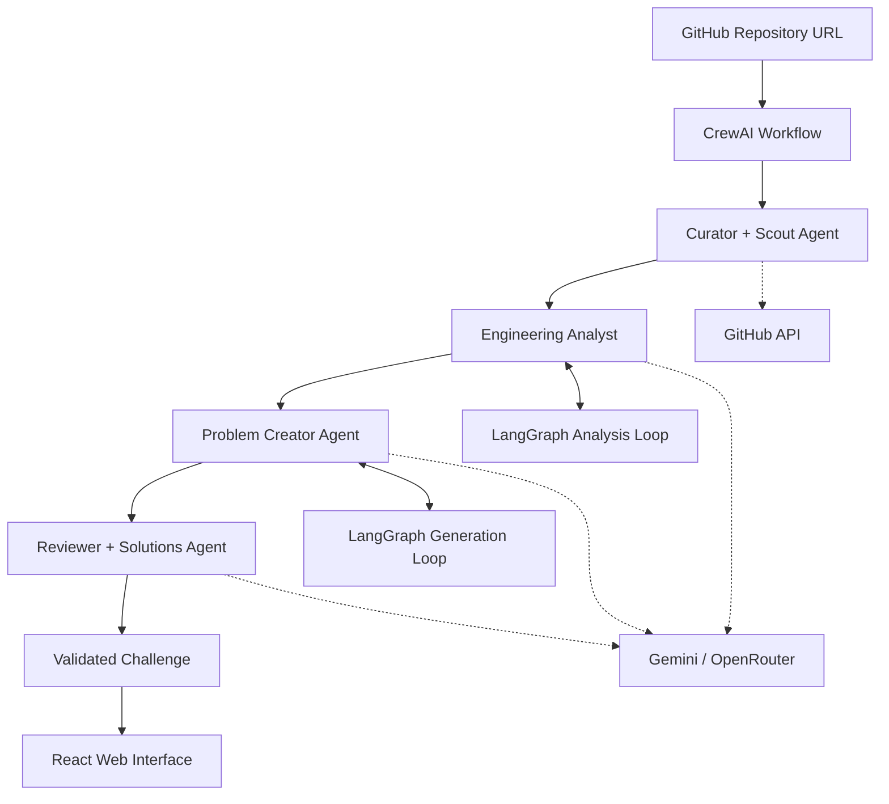

# Accelerate

**Turn real-world open-source engineering into hands-on programming challenges.**

Accelerate is an agentic learning platform that transforms meaningful commits from popular open-source repositories into interactive programming and system-design challenges.

Instead of learning software engineering only through tutorials and predefined exercises, Accelerate lets you explore how real software evolves. Enter a GitHub repository, and a team of AI agents investigates its commit history, reconstructs the engineering problem behind a change, and turns it into a challenge you can solve yourself.

## The Idea

Great engineering lessons are hidden inside open-source repositories: performance bottlenecks, architectural decisions, concurrency problems, scalability challenges, and clever algorithmic improvements.

Accelerate aims to uncover these lessons and turn them into opportunities to learn by doing.

**The core loop:**

1. Enter a GitHub repository.
2. Discover a meaningful engineering change.
3. Understand the problem and constraints behind it.
4. Receive a challenge inspired by the real-world change.
5. Solve it, review the solution, and learn from the original implementation.

## Features

- **Repository-to-challenge generation:** Submit a GitHub repository URL and automatically discover a meaningful commit.
- **AI-powered engineering analysis:** Reconstruct the problem, constraints, and technical trade-offs behind a change.
- **Dynamic problem generation:** Convert real engineering work into a self-contained challenge.
- **Interactive coding interface:** Solve problems in a clean, HackerRank-inspired environment.
- **Solution review:** Compare your approach with an AI-generated solution and learn from the original implementation.
- **Explore challenges:** Browse a curated collection of problems generated from open-source projects.

## How It Works

Accelerate uses a multi-agent workflow orchestrated by CrewAI, with LangGraph powering the more complex reasoning workflows.

### 1. Curator + Scout Agent

Finds promising repositories and investigates their commit histories.

Responsibilities:
- Retrieve commits and associated metadata through the GitHub API.
- Identify potentially meaningful changes.
- Filter out trivial changes such as formatting, typo fixes, and routine dependency updates.
- Select commits that contain enough engineering substance to become useful challenges.

### 2. Engineering Analyst Agent

Reconstructs the engineering problem behind a selected commit.

Responsibilities:
- Inspect the commit diff and surrounding code.
- Retrieve relevant parent-version code, tests, pull requests, and issue discussions where available.
- Infer the original problem, requirements, constraints, and technical trade-offs.
- Identify missing information and retrieve additional evidence when necessary.

**Powered by LangGraph:** This agent follows an iterative analysis workflow, gathering evidence and refining its understanding until it has enough information or reaches a defined limit.

### 3. Problem Creator Agent

Transforms the engineering analysis into a challenge that can be solved independently.

Responsibilities:
- Define a clear problem statement.
- Specify functional requirements and constraints.
- Provide relevant inputs, outputs, and examples.
- Include edge cases and failure scenarios.
- Create test cases and evaluation criteria where applicable.
- Ensure the challenge does not depend on knowing the original implementation.

**Powered by LangGraph:** An iterative generation workflow checks whether the problem is clear, grounded in the available evidence, and sufficiently self-contained before returning it.

### 4. Reviewer + Solutions Agent

Acts as the final quality gate.

Responsibilities:
- Verify that the challenge is consistent with the repository evidence.
- Check that the requirements are unambiguous and the problem is solvable.
- Generate a reference solution or solution outline appropriate to the challenge.
- Validate examples and test cases where possible.
- Identify answer leakage, unsupported assumptions, and unnecessary complexity.
- Request revisions or reject low-quality challenges.

The workflow should use bounded retries and reject challenges that cannot be grounded reliably in the available evidence.

## Agent Architecture

Accelerate combines two complementary orchestration tools.

| Technology | Responsibility |
|---|---|
| CrewAI | Connects the agents and coordinates the overall workflow. |
| LangGraph | Manages stateful, iterative reasoning inside the Engineering Analyst and Problem Creator agents. |
| Gemini | Primary language model for analysis and generation. |
| OpenRouter | Fallback model access when the primary provider is unavailable or unsuitable. |

The overall workflow is coordinated by CrewAI, while selected agents use LangGraph to manage their internal state, conditional transitions, and reasoning loops.

The goal is not to make every agent autonomous. Each agent has a defined responsibility, structured inputs and outputs, and clear stopping conditions.

## User Interface

Accelerate will have a minimalist web interface focused on discovering and solving engineering problems.

### Home page

- A clean landing page with a GitHub repository input bar.
- A prominent action to generate a challenge.
- A featured problems section containing curated challenges from open-source projects.

### Challenge page

The challenge interface will take inspiration from HackerRank, prioritizing readability and an uninterrupted solving experience.

Planned elements include:
- Problem description and engineering context.
- Requirements, constraints, examples, and test cases.
- A code editor and language selection.
- Run and submit controls.
- Test results and execution feedback.
- A solution and explanation section, revealed when the learner is ready.

System-design challenges may use a structured answer interface instead of a code editor when executable code is not the appropriate way to evaluate a solution.

## Technology Stack

| Layer | Technology |
|---|---|
| Language models | Google Gemini, with OpenRouter as fallback |
| Multi-agent orchestration | CrewAI |
| Stateful agent workflows | LangGraph |
| Repository data | GitHub API |
| Structured outputs and validation | Pydantic |
| Backend API | FastAPI |
| Frontend | React + Vite |
| Database | SQL-based persistence |

The GitHub integration will handle repository metadata, commit history, diffs, and related engineering context. Pydantic models will define structured data contracts between agents, while FastAPI will expose the backend to the frontend.

The database will support persistence for generated challenges and related metadata.

## Guiding Principles

**Ground challenges in real engineering.** Every challenge should be traceable to repository evidence. The system must distinguish documented facts from inferred design intent.

**Teach, don't just generate.** The objective is to help learners develop engineering judgment, not merely produce more exercises.

**Reward understanding.** Challenges should require reasoning about algorithms, architecture, constraints, and trade-offs rather than reproducing the original code.

**Quality over quantity.** A small number of well-grounded, thoughtfully designed challenges is more valuable than a large collection of generic AI-generated problems.

**Keep the learner in control.** Solutions and explanations should help learners understand their mistakes without removing the opportunity to solve the challenge independently.

## Development Roadmap

- [ ] **Phase 1 — Repository ingestion:** Accept a GitHub URL and retrieve repository metadata, commits, and diffs.
- [ ] **Phase 2 — Commit selection:** Build the Curator + Scout workflow to identify meaningful engineering changes.
- [ ] **Phase 3 — Engineering reconstruction:** Implement the Engineering Analyst with a LangGraph analysis loop.
- [ ] **Phase 4 — Challenge generation:** Build the Problem Creator with structured, validated outputs.
- [ ] **Phase 5 — Quality assurance:** Implement the Reviewer + Solutions Agent and bounded revision loops.
- [ ] **Phase 6 — Backend integration:** Expose the workflow through FastAPI and persist challenges in SQL.
- [ ] **Phase 7 — Frontend:** Build the repository input page, featured problems section, and HackerRank-inspired challenge interface.
- [ ] **Phase 8 — Evaluation:** Test challenge quality, grounding, solvability, generation latency, and cost.

## The Long-Term Vision

Accelerate aims to make the world's open-source engineering knowledge more accessible.

Every meaningful commit is a potential lesson. By turning those lessons into interactive challenges, Accelerate can help developers move beyond writing code that works toward understanding why systems are designed the way they are, what constraints shape engineering decisions, and how to solve unfamiliar problems independently.

**Learn from the code that builds the world.**
