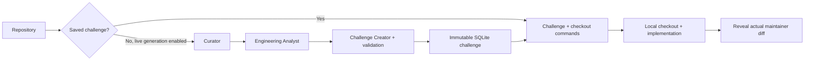

# Accelerate

Learn engineering by fixing real open-source code in your own environment.

Accelerate turns meaningful GitHub commits into focused local-repository challenges.
It gives you an issue statement, acceptance criteria, relevant directories/files,
and Git commands to check out the **parent revision before the fix**. Use your editor
and the repository's tools, then reveal the actual maintainer diff to compare approaches.

## Learner workflow

1. Enter a GitHub repository URL or `owner/repository`, or open a saved challenge.
2. Copy the checkout commands into your terminal. They clone into a fresh folder,
   check out the exact parent SHA, and create an `accelerate/` working branch.
3. Read the checkout's README/contribution guide and set up its environment.
4. Implement your solution and run the relevant repository tests/build checks locally.
5. Inspect `git diff <parent-sha>`, then reveal the maintainer's original patch.

Different patches can be correct. Compare behavior, maintainability, and trade-offs;
Accelerate does not grade code or execute learner submissions. Git diff includes tracked
files; use `git add -N <new-file>` to include new files before comparing.

The normal challenge responses exclude the fix SHA, commit message, PR description,
and patch. Reveal fetches those separately. This is a learning reveal, not secrecy:
the original fix remains discoverable in the public repository's history.

## Architecture



FastAPI exposes the local challenge API. LangGraph orchestrates generation and the
bounded Analyst and Creator loops. Gemini is primary; OpenRouter is fallback.
The Analyst reconstructs the before/after change. The Creator writes the task and
acceptance criteria, without duplicating source files, creating synthetic hidden tests,
or generating a reference implementation. Paths are grounded before validation;
malformed drafts and unsupported paths can be revised within the iteration limit.
Git commands and source links are assembled deterministically from verified metadata.

Generation first reuses saved challenges. If none exist, live generation can reuse a
cached analyst context before scouting GitHub. Creating a new statement from an analyst
cache still calls the LLM. Cached-only requests use saved challenges and never call
GitHub or an LLM; cache misses return HTTP 409.

## Local setup

Requires Python 3.12+, Node.js 20.19+ or 22.12+, and Git.

```powershell
python -m venv .venv
Copy-Item .env.example .env
& .\.venv\Scripts\python.exe -m pip install -r requirements.txt
```

Add `GITHUB_TOKEN`, `GEMINI_API_KEY`, and optional `OPENROUTER_API_KEY` for live
generation. Saved demos require no credentials. Model IDs are configurable with
`GEMINI_MODEL` and `OPENROUTER_MODEL`; choose IDs available to your provider account.

Load the curated Flask and xxHash demos derived from existing cached data:

```powershell
& .\.venv\Scripts\python.exe -m app.seed_cached --demo
& .\.venv\Scripts\python.exe -m uvicorn app.api:app --reload
```

In a second terminal:

```powershell
Set-Location frontend
npm install
npm run dev
```

Open http://localhost:5173. The API defaults to http://localhost:8000.
`frontend/.env.example` documents `VITE_API_URL`. CORS permits localhost and
127.0.0.1 on port 5173; configure `ACCELERATE_CORS_ORIGINS` for other clients.
The frontend starts in saved-only mode. Turn that option off to allow live generation.

Saved challenges use `.data/accelerate.sqlite3` (`local_challenges` table); analyst
snapshots use `.cache/analyst`. The old prototype tables remain untouched. To import
other legacy generated challenges instead of curated demos, run `python -m app.seed_cached`
and inspect their statements for quality. Seed operations are idempotent; saved
challenges are immutable for a repository/fix SHA. The demos have manually edited
statements but unmodified cached commit evidence. Their environment setup and fixes
have not been executed in the source repositories as part of this implementation.

## API

| Endpoint | Purpose |
| --- | --- |
| `GET /health` | API readiness |
| `GET /challenges?limit=20` | Saved learner-facing challenges |
| `POST /challenges/generate` | Open a saved challenge or explicitly generate one |
| `GET /challenges/{id}` | Statement, scope, and local checkout commands |
| `GET /challenges/{id}/solution` | Explicit reveal of original commit evidence and comparison commands |

Generation request:

```json
{"github_url": "pallets/flask", "use_cache": true, "cache_only": true}
```

Set `cache_only: false` to permit model calls on a cache miss. New generation is
synchronous in this iteration; the frontend waits up to five minutes. Async jobs,
progress tracking, and candidate reselection after downstream rejection remain future work.
The previous code submission/review endpoints and hosted execution runner are removed.

## Verification without token costs

```powershell
& .\.venv\Scripts\python.exe -B -m unittest discover -s tests -p 'test_*.py' -v
Set-Location frontend
npm test
npm run build
```

Tests use the checked-in cached demo evidence and mocked providers, covering cache-only
behavior, solution privacy, parent revision checkout commands, immutable persistence,
non-Python tasks, invalid drafts, and bounded validation. Tests do not execute remote
repository setup or require provider credentials. CLI scripts `test.py`,
`tests/analyst_test.py`, and `tests/langgraph_generation_test.py` are manual live
experiments and can incur provider costs; they are not part of automated discovery.
Install `requirements-dev.txt` if your environment needs the HTTP test-client dependency.

## Current development status

- Implemented: repository ingestion, commit selection, bounded analysis/generation,
  SQLite persistence, cached demos, local checkout instructions, minimal React UI,
  and explicit maintainer diff reveal.
- Next: verify challenge quality across repositories, measure generation cost/latency,
  improve setup evidence retrieval, and move live generation into background jobs.
- Possible later addition: optional AI feedback on a learner's patch. This version
  focuses on local verification and self-comparison, with no generated scores.
